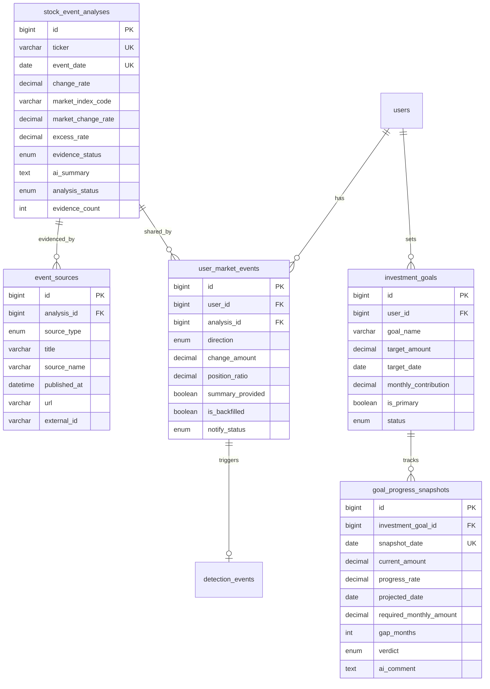
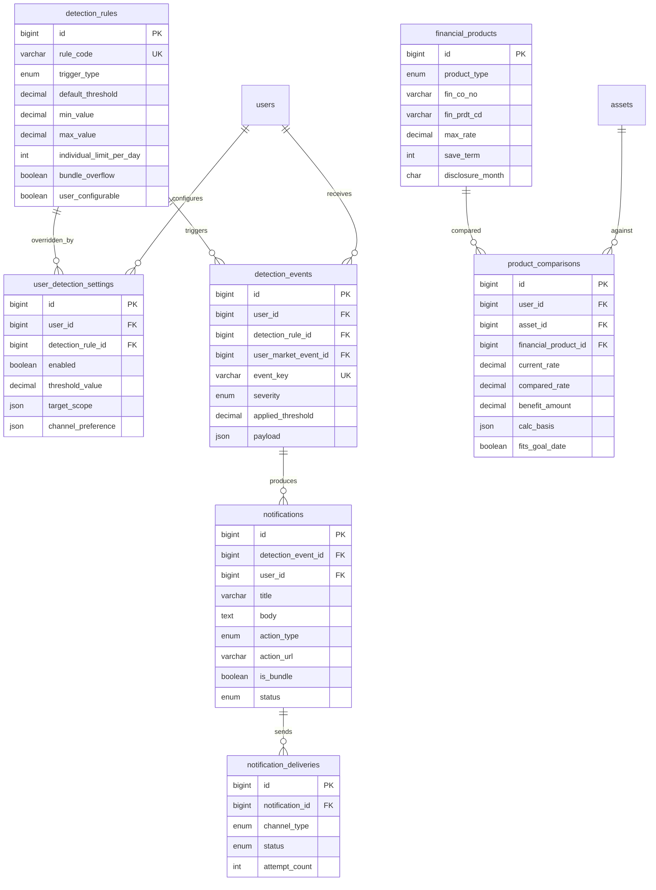

# ERD 및 테이블 설계서

**프로젝트명**: 자산 가계부 — 증권 자산 변화 기록 · 분석 플랫폼
**DBMS**: MySQL 8.0 (InnoDB, utf8mb4) + Redis
**버전**: v4.2 (방향성 v6.1 기준)

---

## 1. 설계 개요

### 1.1 변경 이력

**v4.2 — 6주차 구현 확정 반영 (2026-10-27, D-02 · D-06 ~ D-19)**

| 구분 | 테이블 | 내용 |
|---|---|---|
| 규칙 | holdings | `security_type` = 한투 종목정보 증권그룹 `EF` → ETF, `ST` → STOCK, 그 외 NULL. CODEF 재동기화 때 유지 (§4.6) |
| 규칙 | asset_snapshots | 거래정지 종목은 직전 종가로 평가해 성공 · 수기 자산만 있어도 기록 · EMPTY_RESULT는 누락(임시) (§4.7) |
| 규칙 | asset_snapshots | 첫 행 = 연동 뒤 첫 정기 배치일 (§4.7 · §11.1) |
| 규칙 | asset_snapshots | 자산군 대상이 전부 실패하면 NULL, 대상 없으면 0 · 재실행 시 기존 COMPLETE를 덮어쓰지 않음 · 판정 대상 시각 T = 배치 시작 시각 (§4.7) |
| 변경 | asset_snapshots | `day_change_rate` 퍼센트, 소수 4자리 HALF_UP (§4.7) |
| 추가 | asset_snapshots · asset_detail_snapshots · stock_prices | `created_at` · `updated_at` (`BaseTimeEntity`) |
| 변경 | asset_detail_snapshots | `day_change_amount` NULL 허용, 기준 행 정의 · ticker NULL 행은 앱 upsert로 유일성 보장 (§4.8) |
| 규칙 | stock_prices | 원주가 종가, `change_rate` = `prdy_ctrt`, `prev_close_price` = 직전 거래일 종가(참고용) (§4.9) |
| 규칙 | 공통 | 평가액은 종목별 HALF_UP 소수 2자리 후 합산 (§1.3) |
| 규칙 | sync_jobs | EMPTY_RESULT = SUCCESS + 결과 errorType EMPTY_RESULT (§4.3) |
| 변경 | 배치 흐름 | 가드 → 거래일 판정 → CODEF → 시세 → 판정 (§11.2) |
| 추가 | 메트릭 | `external.api.*` `api` 태그, `market.price.collect`, `batch.run` (§12) |

> 테이블 수 변동 없음 (28개).

**v4.1 — 방향성 v6 (기획 피드백) 반영**

| 구분 | 테이블 | 내용 |
|---|---|---|
| 추가 | asset_snapshots | `status` · `collected_at` · `base_snapshot_date` · `market_change_amount` · `other_change_amount` |
| 삭제 | asset_snapshots | `is_backfilled` — 과거 자산 스냅샷을 만들지 않음 |
| 규칙 | asset_detail_snapshots | 수집 실패 자산은 그날 행을 만들지 않음 (직전 값 이월 금지) |
| 추가 | sync_jobs | `target_date` — 스냅샷 수집 상태 판정 근거 |
| 추가 | holdings | `security_type` (STOCK / ETF) |
| 규칙 | assets | 자산군 집계 규칙 명시 — 예수금 · 입출금 → CASH |
| 변경 | monthly_reports | `asset_class_contribution` → `asset_class_changes`, `market_change_amount` · `other_change_amount` 추가 |
| 변경 | stock_event_analyses | `confidence`(4등급) → `evidence_status`(3상태) |
| 변경 | event_sources | `published_at` NULL 허용 — 시각 미제공 근거 대응 |
| 변경 | user_market_events | 소급 이벤트는 사용자 금액 필드 NULL |
| 변경 | goal_progress_snapshots | 수익률 0% 시뮬레이션, `required_monthly_amount` 추가, `monthly_growth_avg` 참고용, `ai_comment` 이벤트 기반 |
| 추가 | product_comparisons | `calc_basis` — 예상 수령액 계산 기준, `benefit_amount` 의미 변경 |
| 변경 | notification_channels | `channel_type` WEB_PUSH / EMAIL |
| 변경 | Redis | 목표 코멘트 키 이벤트 기반, 알림 큐 키는 후보 |

> 테이블 수 변동 없음 (28개).

**v4 — v3 대비**

| 구분 | 내용 |
|---|---|
| **분리** | `market_events` → `stock_event_analyses`(종목 · 날짜 공유) + `user_market_events`(사용자별) |
| **추가** | `monthly_reports` (월간 결산) |
| **변경** | `event_sources` FK 대상 → `stock_event_analyses` |
| **변경** | `detection_events.market_event_id` → `user_market_event_id` |
| **변경** | `goal_progress_snapshots` 주간 → **일간**, 코멘트 컬럼 추가 |
| **변경** | `detection_rules` 초기 데이터 — 월간 결산 · 묶음 알림 반영 |
| **추가** | Redis 키 설계 (AI 한도 카운터 · 분산 락 · 캐시) |

### 1.2 도메인 구분

| 층 | 도메인 | 테이블 | 수 |
|---|---|---|---|
| 공통 | 사용자 · 인증 | users, user_settings, notification_channels, push_subscriptions | 4 |
| 기반 | 기관 연동 | institutions, connected_accounts, sync_jobs | 3 |
| 기반 | 자산 기록 | assets, deposit_details, holdings, asset_snapshots, asset_detail_snapshots | 5 |
| 기반 | 시장 데이터 | stock_prices, macro_indicators | 2 |
| 기반 | **월간 결산** | monthly_reports | 1 |
| 핵심 ① | 원인 분석 | **stock_event_analyses**, event_sources, **user_market_events** | 3 |
| 핵심 ② | 투자 목표 | investment_goals, goal_progress_snapshots | 2 |
| 핵심 ③ | 예적금 | financial_products, product_comparisons | 2 |
| 전달 | 감지 · 알림 | detection_rules, user_detection_settings, detection_events, notifications, notification_deliveries | 5 |
| | | **합계** | **27** |

> 운영 지표는 Micrometer → Prometheus로 수집하므로 **별도 테이블을 두지 않는다.**
> Refresh Token은 테이블 대신 Redis에 저장한다(§3.3, §9). `refresh_tokens`가 빠져 테이블 수는 27개다. 소셜 로그인(연결 계정 테이블)은 향후 확장이라 두지 않는다.

### 1.3 설계 원칙
- **PK**: `BIGINT AUTO_INCREMENT` 대리키
- **타입**: 금액 `DECIMAL(18,2)` / 비율 · 수익률 `DECIMAL(8,4)` / 금리 `DECIMAL(5,3)`
- **반올림**: 평가액(종가 × 수량)은 종목별로 HALF_UP 소수 2자리 후 합산 — 자산별 상세 합과 자산군 금액이 일치. 변화율은 퍼센트, HALF_UP 소수 4자리
- **암호화**: 접미사 `_enc`, AES-256. 마스킹 값은 별도 컬럼
- **멱등성**: 외부 수집 · 공유 분석 · 사용자 이벤트 · 감지 이벤트 · 결산에 유니크 제약
- **스냅샷 분리**: 현재 상태(assets · holdings)와 기록(snapshots)을 분리 — 자산 기록 · 추이 · 감지 · 결산의 원천
- **공유와 개인의 분리**: 종목 · 날짜에 속하는 사실은 공유 테이블, 사용자 비중 · 손익은 사용자 테이블
- **설정의 계층화**: 시스템 기본값(`detection_rules`) + 사용자 오버라이드(`user_detection_settings`)
- **사전 저장**: 기록 · 결산 · 진척은 배치에서 계산해 저장하고, 조회는 저장값으로 응답
- **불완전 기록 격리**: 수집 상태가 COMPLETE가 아닌 스냅샷은 저장하되 비교 · 감지 · 결산 · 목표 계산에서 제외
- **사실만 기록**: 확인할 수 없는 과거 자산은 소급 생성하지 않고, 실패한 값을 직전 값으로 채우지 않는다

---

## 2. ERD

### 2.1 사용자 · 연동

```mermaid
erDiagram
    users ||--|| user_settings : has
    users ||--o{ notification_channels : registers
    users ||--o{ push_subscriptions : subscribes
    users ||--o{ connected_accounts : owns
    institutions ||--o{ connected_accounts : provides
    connected_accounts ||--o{ sync_jobs : logs

    users {
        bigint id PK
        varchar email_enc
        varchar email_hash UK
        varchar password_hash
        varchar nickname
        enum status
        varchar terms_version
    }
    user_settings {
        bigint user_id PK_FK
        boolean notification_enabled
        time quiet_hours_start
        time quiet_hours_end
        boolean onboarding_completed
    }
    notification_channels {
        bigint id PK
        bigint user_id FK
        enum channel_type
        varchar destination_enc
        boolean is_active
    }
    push_subscriptions {
        bigint id PK
        bigint user_id FK
        text endpoint
        varchar p256dh
        varchar auth_key
    }
    institutions {
        bigint id PK
        varchar codef_org_code UK
        varchar name
        enum institution_type
    }
    connected_accounts {
        bigint id PK
        bigint user_id FK
        bigint institution_id FK
        varchar connected_id_enc
        varchar account_password_enc
        enum business_type
        enum status
    }
    sync_jobs {
        bigint id PK
        bigint connected_account_id FK
        date target_date
        enum job_type
        enum status
        enum error_type
    }
```

### 2.2 자산 기록 · 시장 데이터 · 월간 결산 (기반)

```mermaid
erDiagram
    users ||--o{ assets : owns
    connected_accounts ||--o{ assets : sources
    assets ||--o| deposit_details : detail
    assets ||--o{ holdings : contains
    assets ||--o{ asset_detail_snapshots : records
    users ||--o{ asset_snapshots : records
    users ||--o{ monthly_reports : receives

    assets {
        bigint id PK
        bigint user_id FK
        bigint connected_account_id FK
        enum asset_type
        enum asset_class
        varchar account_number_enc
        varchar account_number_masked
        decimal balance
    }
    deposit_details {
        bigint asset_id PK_FK
        decimal interest_rate
        date maturity_date
        decimal principal
        int save_term
        boolean auto_renew
    }
    holdings {
        bigint id PK
        bigint asset_id FK
        varchar ticker
        varchar stock_name
        enum security_type
        decimal quantity
        decimal avg_buy_price
        decimal eval_amount
        decimal profit_loss_rate
    }
    asset_snapshots {
        bigint id PK
        bigint user_id FK
        date snapshot_date UK
        enum status
        datetime collected_at
        decimal total_asset
        decimal securities_amount
        decimal deposit_amount
        decimal cash_amount
        date base_snapshot_date
        decimal day_change_amount
        decimal market_change_amount
        decimal other_change_amount
        boolean has_event
    }
    asset_detail_snapshots {
        bigint id PK
        bigint asset_id FK
        varchar ticker
        date snapshot_date UK
        decimal amount
        decimal day_change_amount
    }
    stock_prices {
        bigint id PK
        varchar ticker UK
        date trade_date UK
        decimal close_price
        decimal change_rate
    }
    macro_indicators {
        bigint id PK
        varchar indicator_code UK
        date base_date UK
        decimal value
        decimal change_rate
    }
    monthly_reports {
        bigint id PK
        bigint user_id FK
        char report_month UK
        decimal start_total_asset
        decimal end_total_asset
        decimal change_amount
        decimal change_rate
        decimal market_change_amount
        decimal other_change_amount
        json asset_class_changes
        json top_events
        json stock_ranking
        json goal_progress
        json checkpoints
        text ai_summary
        enum status
    }
```

### 2.3 원인 분석 · 투자 목표 (핵심 ① ②)



### 2.4 감지 · 알림 · 예적금 (전달 · 핵심 ③)



---

## 3. 테이블 상세 — 공통

### 3.1 users
| 컬럼 | 타입 | 제약 | 설명 |
|---|---|---|---|
| id | BIGINT | PK | |
| email_enc | VARCHAR(512) | NN | 로그인 ID — AES-256-GCM 암호화. 소문자 · 공백 제거로 정규화한 뒤 저장 |
| email_hash | VARCHAR(64) | UNIQUE, NN | SHA-256(정규화 이메일) Base64 — 조회 · 중복 검사용 |
| password_hash | VARCHAR(60) | NULL | Bcrypt. 비밀번호 8~64자 · UTF-8 72바이트 이하(FR-AU-01). NULL 허용은 소셜 로그인 확장 대비 — 현재 가입 경로는 항상 저장하므로 NULL 행이 생기지 않음 |
| nickname | VARCHAR(50) | NN | |
| status | ENUM | D:'ACTIVE' | ACTIVE / DORMANT / WITHDRAWN — ACTIVE가 아니면 로그인 · 토큰 갱신 차단. DORMANT(휴면) 전환 · 해제는 **범위 제외** (값만 유지) |
| withdrawn_at | DATETIME | NULL | |
| email_verified_at | DATETIME | NULL | 이메일 인증 시각 — 가입 전 인증을 거치므로 가입 시각으로 기록 |
| terms_version | VARCHAR(20) | NN | 가입 시 동의한 약관 버전 |
| created_at / updated_at | DATETIME | NN | |

### 3.2 user_settings
| 컬럼 | 타입 | 설명 |
|---|---|---|
| user_id | BIGINT PK, FK | |
| notification_enabled | BOOLEAN D:true | 전체 알림 스위치 |
| quiet_hours_start / end | TIME NULL | 방해 금지 |
| timezone | VARCHAR(50) D:'Asia/Seoul' | |
| onboarding_completed | BOOLEAN D:false | |
| backfill_completed | BOOLEAN D:false | 최초 연동 시 보유 종목 30일 시세 · 과거 이벤트 소급 완료 여부 (자산 스냅샷 소급 아님) |

### 3.3 refresh_tokens
> **테이블을 두지 않고 Redis에 저장한다** (키는 §9). 토큰 원문이 아니라 SHA-256 해시를 키로 쓴다.

| 항목 | 규칙 |
|---|---|
| 저장 | `auth:rt:token:{sha256(RT)}` → `{userId}`, 사용자 인덱스 `auth:rt:user:{userId}` (RT 해시 Set). TTL = RT 만료(14일) |
| 세션 단위 | 기기별 다중 세션 — 사용자당 RT 여러 개 |
| Rotation 추적 | `rotated_from` 대신, 회전된 토큰 키에 `rotated:{userId}` 표식을 남긴다(원래 만료까지 유지) |
| 재사용 탐지 | 회전된 RT가 다시 오면 그 사용자의 RT를 전부 무효화 |
| 무효화 범위 | 로그아웃은 현재 RT만. 비밀번호 재설정 · 재사용 탐지 · 탈퇴는 사용자 단위 전체 |

### 3.4 notification_channels
| 컬럼 | 타입 | 설명 |
|---|---|---|
| id | BIGINT PK | |
| user_id | BIGINT FK | |
| channel_type | ENUM | WEB_PUSH / TELEGRAM — 사용자 채널 (2026-10-11: EMAIL → TELEGRAM 교체, EMAIL 알림은 향후 확장, DISCORD는 사용자 채널 아님) |
| destination_enc | VARCHAR(512) NULL | AES-256 — TELEGRAM은 chat_id, WEB_PUSH는 NULL (`push_subscriptions` 사용). 텔레그램 연결 흐름 · 임시 연결 토큰 저장 방식 `[구현 시 확정]` |
| is_active | BOOLEAN D:true | |

> UNIQUE (user_id, channel_type)
> 개발자 운영 · 배포 알림(Discord 웹훅)은 사용자 데이터가 아니므로 테이블에 두지 않고 환경 설정으로 관리한다.

### 3.5 push_subscriptions
| 컬럼 | 타입 | 설명 |
|---|---|---|
| id | BIGINT PK | |
| user_id | BIGINT FK | |
| endpoint | TEXT NN | |
| p256dh / auth_key | VARCHAR(255) | |
| user_agent | VARCHAR(255) | 기기 구분 |
| revoked_at | DATETIME NULL | |

---

## 4. 테이블 상세 — 기반 (자산 가계부)

### 4.1 institutions
| 컬럼 | 타입 | 설명 |
|---|---|---|
| id | BIGINT PK | |
| codef_org_code | VARCHAR(20) UNIQUE | |
| name | VARCHAR(100) | |
| institution_type | ENUM | BANK / SECURITIES |

> 초기 데이터는 기동 시 멱등 입력한다(id 고정 + `codef_org_code` 기준 upsert). CODEF 기관 목록과 일치 — 증권사 22개, 은행 20개, 이름은 CODEF 공식 표기. CODEF 미지원 기관(카카오뱅크 · 토스뱅크)은 넣지 않는다.

### 4.2 connected_accounts
| 컬럼 | 타입 | 설명 |
|---|---|---|
| id | BIGINT PK | |
| user_id / institution_id | BIGINT FK | |
| connected_id_enc | VARCHAR(512) NULL | AES-256 — 해지 시 NULL로 즉시 파기 |
| account_password_enc | VARCHAR(512) NULL | AES-256 — 증권 계좌 비밀번호(CODEF 종합자산 조회용). 해지 시 NULL로 파기 |
| business_type | ENUM | BK(은행) / ST(증권) — CODEF 요청 clientType은 BK=P(개인), ST=A(통합). 기관 유형과 업무 구분이 다르면 연결 거부 |
| status | ENUM | ACTIVE / AUTH_FAILED / EXPIRED / DISCONNECTED(연동 해지) |
| last_synced_at | DATETIME | |
| created_at | DATETIME | `updated_at`은 두지 않음 |

> UNIQUE (user_id, institution_id, business_type)
> **재연결**: 같은 기관을 다시 연결하면(AUTH_FAILED · EXPIRED · DISCONNECTED 포함) 기존 행을 갱신한다 — 이전 connectedId를 CODEF에서 먼저 삭제하고 새 connectedId · ACTIVE로 바꾼다.
> **해지**: CODEF 계정 삭제 호출(실패해도 진행) → status DISCONNECTED, `connected_id_enc` · `account_password_enc` NULL, **행은 유지**.
> **상태 전이**: 검증된 오류 코드에 한해 인증 정보 오류 → AUTH_FAILED, 인증 · 연동 만료 → EXPIRED. 그 외 오류는 상태를 유지한다(04 FR-CN-06 표). 재인증에 성공하면 ACTIVE로 복구한다.

### 4.3 sync_jobs
| 컬럼 | 타입 | 설명 |
|---|---|---|
| id | BIGINT PK | |
| connected_account_id | BIGINT FK | |
| target_date | DATE | 수집 대상 기준일 — 해당 날짜 스냅샷의 수집 상태 판정에 사용 |
| job_type | ENUM | BALANCE / HOLDING / DEPOSIT / BACKFILL — BACKFILL은 최초 연동 수집 (과거 자산 스냅샷 생성 아님) |
| status | ENUM | RUNNING / SUCCESS / FAILED |
| collected_count | INT | |
| error_type | ENUM NULL | CODEF 오류 분류 — AUTH_ERROR / AUTH_UNRECOVERABLE / AUTH_EXPIRED / NETWORK_ERROR / TRANSIENT_ERROR / RATE_LIMIT_ERROR / PERMANENT_ERROR / INSTITUTION_UNAVAILABLE / COOLDOWN / EMPTY_RESULT / UNSUPPORTED_OPERATION / OPERATION_PERMISSION_DENIED / UNKNOWN (코드 대응은 04 FR-CN-06) |
| started_at / finished_at | DATETIME | |
| error_message | TEXT NULL | 사용자용 문구만 저장 — 계좌번호 · connectedId · CODEF 응답 원문은 넣지 않음 |

> **job_type 사용**: 증권은 CODEF 종합자산 1회 호출로 예수금 · 보유 종목을 함께 받으므로 HOLDING 1행으로 기록한다(증권에 BALANCE는 쓰지 않음). 최초 연동 수집은 BACKFILL.
> **기록 시점**: 실행마다 1행. RUNNING으로 먼저 기록(커밋)한 뒤 SUCCESS / FAILED로 바꾼다. 같은 연동 계정의 동기화가 진행 중이면(락 충돌) 행을 만들지 않는다.
> **응답 불완전**: 예수금 · 종목 수량 · 평가금액이 없거나 해석할 수 없을 때, 종목별 조회 실패 · 종목코드 누락이 있을 때는 FAILED(UNKNOWN)로 기록하고 assets · holdings를 **부분 갱신하지 않는다**. 기존 값은 남지만 그날 정상 수집한 값으로 인정하지 않는다. 정상 숫자 0은 누락이 아니다.
> **계좌 동기화 FAILED ≠ 스냅샷 FAILED**: 한 계좌가 실패해도 다른 유효 자산이 있으면 그날 스냅샷은 PARTIAL이다(§4.7).
> **조회 결과 없음(EMPTY_RESULT)**: sync_jobs는 SUCCESS로 남기고 assets · holdings는 바꾸지 않는다. 동기화 결과에는 EMPTY_RESULT를 표시해, 일별 스냅샷은 그 계좌를 **누락**으로 판정한다(DB에 남은 예전 값을 쓰지 않음). 임시 정책 — CODEF 실제 응답 확인 후 재검토
> **수동 새로고침과 분리**: 수동 새로고침(FR-CN-09)도 같은 서비스로 이 표에 기록되고 job_type은 HOLDING이다. job_type은 작업 내용 분류일 뿐 실행 출처(배치/수동)를 구분하지 않으므로, 스냅샷 상태는 `(connected_account_id, target_date)`의 마지막 성공 행으로 판정하지 않고 **그 배치 실행에서 얻은 계좌별 수집 결과(또는 그 실행의 sync_jobs.id 집합)만** 사용한다(§11.2). 연결 유지가 어려워지면 실행 출처 컬럼 도입을 다시 검토한다.

### 4.4 assets
| 컬럼 | 타입 | 설명 |
|---|---|---|
| id | BIGINT PK | |
| user_id | BIGINT FK | |
| connected_account_id | BIGINT FK NULL | 수기 자산은 NULL |
| institution_id | BIGINT FK NULL | 수기 자산은 기관이 없을 수 있어 NULL 허용 |
| asset_type | ENUM | CHECKING / DEPOSIT / SAVINGS / SECURITIES / CASH |
| asset_class | ENUM | SECURITIES / DEPOSIT / CASH — 결산 · 구성 집계 단위. 규칙: 보유 종목 평가액 → SECURITIES, 증권 계좌 예수금 · 입출금 계좌 → CASH, 예금 · 적금 → DEPOSIT. **증권 계좌 행은 CASH**(행의 balance가 예수금)이고, 종목 평가액은 holdings를 합산해 SECURITIES로 집계 |
| name | VARCHAR(100) | |
| account_number_enc | VARCHAR(512) NULL | AES-256 |
| account_number_masked | VARCHAR(50) NULL | |
| balance | DECIMAL(18,2) NULL | 잔액 — 증권 계좌는 예수금 (CODEF 필드 `[확인 필요]`), **첫 정상 수집 전에는 NULL**(0으로 채우지 않음). 수기 자산은 사용자가 입력한 현재 금액(예금 · 적금은 현재 잔액, 현금 · 입출금은 보유액), 0보다 커야 함 |
| is_active | BOOLEAN | 연동 해지 시 false — 행은 유지(자산 기록 참조)하고 해당 holdings는 삭제. **수기 자산 삭제도 false(soft delete)** — 행과 deposit_details를 남긴다 |
| updated_at | DATETIME | |

> 해외 주식은 수집 · 기록하지 않는다. 수기 자산(`connected_account_id` NULL)의 가치 갱신 방식(이자 반영 등) `[구현 시 확정]`
> **수기 자산**: 유형은 DEPOSIT / SAVINGS / CASH만 쓴다 — asset_class는 DEPOSIT · SAVINGS → DEPOSIT, CASH → CASH. **은행 입출금 계좌는 CASH로 입력**하고 이름으로 구분한다(CHECKING은 향후 CODEF 은행 수집용). DEPOSIT · SAVINGS는 `deposit_details`를 필수로 받고 assets와 한 트랜잭션으로 저장한다. 수정 · 삭제는 수기 자산만 가능하다.
> **soft delete 이유**: 자산별 일별 기록(asset_detail_snapshots)이 asset_id를 참조하므로 행을 지우면 과거 기록이 깨진다(01 "사실만 기록"). 비활성 자산은 목록 · 합계 · 수정에서 제외한다.
> 첫 정상 수집 전(NULL)이거나 수집에 실패한 금액은 현재 자산 조회 합계에서 빼고 "불완전"으로 표시한다 — 부분 합계를 정상 총자산처럼 쓰지 않는다(FR-AS-01).
> 증권 계좌 행은 증권 연결 시점에 만든다 — 연결 요청에서 계좌번호(필수, 하이픈 제거) · 계좌 비밀번호(선택)를 받는다. 연동 계정당 증권 계좌 1행(기관당 1계좌).
> **DB 유니크 제약을 두지 않는다** — 같은 유형의 자산이 여러 개일 수 있다(수기 자산 등). 증권 계좌 "연동 계정당 1행"은 앱 코드(조회 후 생성)와 동기화 락으로 보장한다.

### 4.5 deposit_details
| 컬럼 | 타입 | 설명 |
|---|---|---|
| asset_id | BIGINT PK, FK | |
| interest_rate | DECIMAL(5,3) NN | 연 금리(%) — 0 이상, 100 미만 |
| start_date / maturity_date | DATE NN | 만기일은 시작일보다 뒤 |
| principal | DECIMAL(18,2) NN | 0보다 큼 |
| save_term | INT NN | 개월 — 1 이상 |
| auto_renew | BOOLEAN NN | |

> 수기로 등록하는 DEPOSIT · SAVINGS는 이 행을 필수로 받는다. CASH는 행을 만들지 않는다 — 유형을 CASH로 바꾸면 행을 지운다. 자산을 삭제(soft delete)해도 행은 남긴다.

### 4.6 holdings
| 컬럼 | 타입 | 설명 |
|---|---|---|
| id | BIGINT PK | |
| asset_id | BIGINT FK | |
| ticker / stock_name | VARCHAR | |
| security_type | ENUM NULL | STOCK / ETF — ETF는 원인 분석에서 공시 · 뉴스 수집 생략. CODEF는 단일 종목과 ETF를 구분해 주지 않으므로 CODEF 수집 단계에서는 NULL로 저장한다. **시세 수집 때 NULL인 종목만** 한투 종목정보(`search-stock-info`)의 증권그룹 `scty_grp_id_cd`로 채운다 — `EF` → ETF, `ST` → STOCK, 그 외(ETN 등)는 NULL 유지. CODEF 재동기화는 채워진 값을 유지한다 |
| quantity | DECIMAL(18,4) | |
| avg_buy_price / current_price | DECIMAL(18,2) | |
| eval_amount | DECIMAL(18,2) | **한투 종가 × 같은 기준 시점의 보유수량**. 시세 수집 전까지는 CODEF 평가액(`resValuationAmt`)을 임시로 저장 |
| profit_loss / profit_loss_rate | DECIMAL | |
| updated_at | DATETIME | |

> UNIQUE (asset_id, ticker)
> **갱신**: (asset_id, ticker) 기준 upsert. 완전한 응답(§4.3)일 때만 반영하며, 응답에 없는 종목은 보유 종료로 보고 현재 목록에서 삭제한다(과거 asset_detail_snapshots는 보존). 응답에 **명시된** 수량 · 평가(· 매입)가 모두 0인 종목은 저장하지 않는다. 이 정리 규칙은 CODEF 응답이 완전한 보유 목록이고 빈 목록이 정상 무보유를 뜻한다는 전제에 기대므로, 실제 응답으로 확인한다 `[확인 필요]`.
> **0 치환 금지**: 종목코드 · 수량 · 평가금액(CODEF 평가액을 임시로 쓰는 동안)은 필수이고, 없거나 해석할 수 없으면 0으로 바꾸지 않고 응답 불완전으로 처리한다. 매입금액 · 손익 · 수익률은 선택 값 — 수익률로 역산할 수 없으면 NULL로 둔다. 한투 종가 적용 후에는 수량 · 종목코드 · 기준일 종가가 필수다.
> **CODEF 필드 대응**: ticker ← resItemCode, stock_name ← resItemName, quantity ← resQuantity, avg_buy_price ← resAvgPresentAmt(없으면 매입금액 resPurchaseAmount ÷ 수량), current_price ← resPresentAmt(없으면 평가금액 ÷ 수량), eval_amount ← resValuationAmt(임시), profit_loss ← resValuationPL, profit_loss_rate ← resEarningsRate. 종목별 조회 실패는 resResultCode `"0"`(응답 불완전), 해외 종목 판별은 resProductType · resAccountCurrency(04 FR-CN-03)

### 4.7 asset_snapshots — 일별 자산 기록 ★
> **자산 가계부의 "내역" 한 줄.** S-02 자산 기록 화면의 원천.

| 컬럼 | 타입 | 설명 |
|---|---|---|
| id | BIGINT PK | |
| user_id | BIGINT FK | |
| snapshot_date | DATE | 거래일 |
| status | ENUM | **COMPLETE / PARTIAL / FAILED** — 수집 상태 |
| collected_at | DATETIME | 실제 데이터 수집 완료 시각 |
| total_asset | DECIMAL(18,2) NULL | FAILED면 NULL 가능 |
| securities_amount / deposit_amount / cash_amount | DECIMAL(18,2) NULL | 자산군별 수집 성공분 합계. 그 자산군의 대상이 **전부 실패하면 NULL**, 대상 자체가 없으면 0 (실패한 증권 계좌는 증권 · 현금 양쪽의 실패로 센다) |
| base_snapshot_date | DATE NULL | 비교 기준이 된 **직전 COMPLETE 기록** 날짜 — COMPLETE일 때만 |
| day_change_amount | DECIMAL(18,2) NULL | base_snapshot_date 대비 총자산 변화 — COMPLETE일 때만 사전 계산 |
| day_change_rate | DECIMAL(8,4) NULL | 퍼센트(1.2345% → 1.2345), HALF_UP 소수 4자리. 직전 total이 0이면 NULL |
| market_change_amount | DECIMAL(18,2) NULL | **시장가격 영향** — 세부 공식 · 매매일 처리 `[구현 시 확정]` |
| other_change_amount | DECIMAL(18,2) NULL | **기타 자산 변화** = day_change_amount − market_change_amount (원인 아님) |
| has_event | BOOLEAN D:false | 그날 사용자 이벤트 존재 — 🔔 아이콘 |
| created_at / updated_at | DATETIME | 공통(`BaseTimeEntity`) — 재실행 upsert 시각 추적 |

> UNIQUE (user_id, snapshot_date)
> 비교 · 감지 · 하이라이트 · 목표 · 결산 · 추이 조회는 **`status = COMPLETE`만** 사용한다. PARTIAL · FAILED 행은 이력 · 오류 확인용이다.
> **판정 대상(필수 자산)**: 기준 시각 T(= 배치 시작 시각) 이전에 만든 연동 계좌 + 삭제되지 않은 수기 자산. 증권 계좌는 ACTIVE뿐 아니라 수집이 막힌 AUTH_FAILED · EXPIRED도 분모에 포함한다(실제 CODEF 호출은 ACTIVE만). T 시점에 DISCONNECTED인 연동은 제외한다(해지 시각 컬럼이 없어 T 시점 상태로 판정). T 이후 연결된 계좌는 다음 실행부터 대상이다. 수기 자산은 **T 시점의 balance**를 그날 값으로 쓰고, T 이후 수정분은 다음 거래일에 반영한다(이자 반영 등 가치 갱신 방식은 01 §14 #20).
> **판정 단위**: 증권 계좌(실패하면 예수금 · 종목 전체가 실패 1건), 성공한 계좌의 예수금 1건 + 종목별 1건, 수기 자산별 1건. 거래정지 종목은 기준일 이전 최신 종가(stock_prices)로 평가해 성공으로 보고, 그 종가가 없으면 실패다. CODEF 조회 결과 없음(§4.3) · 동기화 락 재시도 실패는 그 계좌 누락이다.
> **상태 조건**: COMPLETE = 필수 대상이 모두 반영되고 종목코드 · 수량 · 예수금 등 필수 데이터가 유효하며 필요한 일별 종가를 같은 기준일로 확보해 합계 계산에 성공. PARTIAL = 일부 누락이지만 유효한 부분 기록 가능. FAILED = 유효한 기록이 성립하지 않음. 대상 자산이 하나도 없으면 COMPLETE(공집합)를 만들지 않고 "기록할 자산 없음"으로 구분한다.
> **수동 새로고침은 스냅샷을 만들거나 덮어쓰지 않는다** — 현재 assets · holdings만 갱신한다.
> **첫 행은 연동 뒤 첫 정기 배치일**이다 — 스냅샷은 정기 배치에서만 만들고 연동 직후에는 만들지 않는다(장중 가격 · 같은 날 UNIQUE 충돌 방지). 수기 자산만 있는 사용자도 기록한다. 과거 날짜 행을 소급 생성하지 않는다 (v4.1: `is_backfilled` 삭제).
> **같은 날 재실행**: 기존 행이 COMPLETE면 PARTIAL · FAILED로 덮어쓰지 않는다. 그 외(같은 등급 · 더 좋은 결과)는 덮어쓰고, 이번에 실패한 자산 · 종목의 기존 상세 행(§4.8)은 지운다.

### 4.8 asset_detail_snapshots — 자산별 일별 기록
| 컬럼 | 타입 | 설명 |
|---|---|---|
| id | BIGINT PK | |
| asset_id | BIGINT FK | |
| ticker | VARCHAR(20) NULL | 종목 단위 기록 시 |
| snapshot_date | DATE | |
| amount | DECIMAL(18,2) | 잔액 또는 평가금액 |
| day_change_amount | DECIMAL(18,2) NULL | 날짜 펼침 상세용 — 총자산과 같은 기준일(**직전 COMPLETE 날짜**)의 같은 (asset_id, ticker) 행 대비. 직전 COMPLETE가 없거나 그날 행이 없으면 NULL(0으로 채우지 않음) |
| created_at / updated_at | DATETIME | 공통(`BaseTimeEntity`) |

> UNIQUE (asset_id, ticker, snapshot_date) — ticker NULL 행(증권 계좌 예수금 · 수기 자산)은 MySQL UNIQUE가 NULL끼리의 중복을 막지 못하므로, 저장 서비스가 조회 후 갱신(upsert)으로 중복을 막는다
> 수집에 실패한 자산은 그날 행을 만들지 않는다 — 직전 값을 복사하지 않는다

### 4.9 stock_prices — 종목 일별 시세
| 컬럼 | 타입 | 설명 |
|---|---|---|
| id | BIGINT PK | |
| ticker / stock_name | VARCHAR | |
| trade_date | DATE | |
| close_price | DECIMAL(18,2) | 원주가 종가(한투 `FID_ORG_ADJ_PRC=0`, 수정주가 미반영) — 평가금액 = 실제 종가 × 실제 수량 |
| prev_close_price | DECIMAL(18,2) | 직전 거래일 종가(참고용). 응답에 직전 거래일 행이 없으면(상장 첫날 · 소급의 가장 오래된 날) 그 날짜 행을 만들지 않는다 |
| change_rate | DECIMAL(8,4) | **전 거래일 대비 변동률** — 한투 `prdy_ctrt` 그대로(기준가 대비 — 액면분할 · 권리락 반영). 직접 계산하지 않으므로 분할일 등에는 `종가 ÷ 전일 종가 − 1`과 다를 수 있다(버그 아님) |
| volume | BIGINT | |
| created_at / updated_at | DATETIME | 공통(`BaseTimeEntity`) |

> UNIQUE (ticker, trade_date) — **사용자와 무관한 공유 데이터**, 보유 종목 합집합만 수집
> 장 마감 가드(설정 `assetory.market.close-guard-time`, 기본 15:40) 전에는 그날 행을 저장하지 않는다 — 장중에는 종가 칸에 현재가가 온다. 기준일 행이 없고 거래정지(`tr_stop_yn=Y`)면 행을 만들지 않고, 일별 기록은 직전 종가로 평가한다(§4.7)

### 4.10 macro_indicators — 지수 · 거시지표
| 컬럼 | 타입 | 설명 |
|---|---|---|
| id | BIGINT PK | |
| indicator_code | VARCHAR(30) | KOSPI / KOSDAQ / BASE_RATE / USD_KRW |
| base_date | DATE | |
| value | DECIMAL(18,4) | |
| change_rate | DECIMAL(8,4) | |
| source | ENUM | KIS / ECOS |

> UNIQUE (indicator_code, base_date)

### 4.11 monthly_reports — 월간 결산 ★ 신규
> 한 달 자산 기록 · 이벤트 · 목표 진척을 모아 저장한다. **새 분석이 아니라 다른 테이블 결과의 스냅샷.**

| 컬럼 | 타입 | 설명 |
|---|---|---|
| id | BIGINT PK | |
| user_id | BIGINT FK | |
| report_month | CHAR(7) | 'YYYY-MM' |
| period_start / period_end | DATE | 실제 기간 (월 중 가입 시 가입일부터) |
| start_total_asset / end_total_asset | DECIMAL(18,2) | 해당 월 첫 · 마지막 **COMPLETE** 기록 |
| change_amount | DECIMAL(18,2) | |
| change_rate | DECIMAL(8,4) | |
| market_change_amount | DECIMAL(18,2) NULL | 월간 시장가격 영향 — 산출 방식 `[구현 시 확정]` |
| other_change_amount | DECIMAL(18,2) NULL | 월간 기타 자산 변화 = change_amount − market_change_amount |
| prev_month_change_amount | DECIMAL(18,2) NULL | 전월 결산의 변화액 — 비교 문구용 |
| asset_class_changes | JSON | 자산군별 증감액 (v4.1 이름 변경 — '기여' 표현 제거) |
| top_events | JSON | 상위 3개 이벤트 요약 (user_market_event_id 포함) |
| stock_ranking | JSON | 상승 · 하락 상위 종목 |
| goal_progress | JSON NULL | 월초 · 월말 진척률 |
| checkpoints | JSON | 다음 달 만기 · 필요 납입액 |
| ai_summary | TEXT NULL | 한 줄 총평 — NULL이면 수치 결산만 |
| status | ENUM | GENERATED / SENT / FAILED |
| generated_at / sent_at | DATETIME | |

> UNIQUE (user_id, report_month)
> 해당 월 COMPLETE 기록이 없으면 수치 결산을 만들지 않는다.

**top_events 예시**
```json
[
  { "userMarketEventId": 812, "date": "2026-09-16", "ticker": "A", "changeRate": -7.2,
    "evidenceStatus": "RELATED_FOUND", "summary": "같은 날 실적 정정 공시가 있었습니다" }
]
```

> JSON으로 저장하는 이유: 결산은 **발행 시점의 사실**이다. 원본 데이터가 나중에 바뀌어도 지난 결산은 그대로 보여야 한다.

---

## 5. 테이블 상세 — 핵심 ① 원인 분석

### 5.1 stock_event_analyses — 공유 분석 ★ 신규 · 핵심
> **종목 · 날짜 단위로 1회만 생성**하고 해당 종목 보유 사용자가 모두 재사용한다.

| 컬럼 | 타입 | 설명 |
|---|---|---|
| id | BIGINT PK | |
| ticker / stock_name | VARCHAR | |
| event_date | DATE | |
| change_rate | DECIMAL(8,4) | 종목 변동률 |
| market_index_code | VARCHAR(30) | KOSPI / KOSDAQ |
| market_change_rate | DECIMAL(8,4) | 같은 날 지수 변동률 |
| excess_rate | DECIMAL(8,4) | 시장 대비 초과 변동 (%p) |
| evidence_count | INT D:0 | 수집된 근거 수 |
| evidence_status | ENUM | RELATED_FOUND / MARKET_MOVE / NOT_FOUND — 아래 표 (v4.1: `confidence` 대체) |
| ai_summary | TEXT NULL | LLM 요약 — 공유 |
| analysis_status | ENUM | 아래 표 |
| llm_prompt_tokens / llm_completion_tokens | INT NULL | 운영 지표용 |
| analyzed_at | DATETIME NULL | |

> UNIQUE (ticker, event_date)

**analysis_status**
| 상태 | 의미 |
|---|---|
| PENDING | 생성됨, 수집 전 |
| COLLECTING | 근거 수집 중 |
| ANALYZED | 요약 완료 |
| NO_EVIDENCE | 근거 0건 — **정상 결과**, LLM 미호출 |
| SUMMARY_SKIPPED | 한도 · 예산 초과로 요약 생략, 근거는 있음 |
| FAILED | LLM 실패, 재시도 대상 |

**evidence_status 판정**
| 상태 | 화면 표현 | 조건 |
|---|---|---|
| RELATED_FOUND | 관련 근거 확인 | 필터(행정성 · 정기성 공시 제외)를 통과한 공시 · 뉴스 1건 이상 |
| MARKET_MOVE | 시장 · 업종 동반 움직임 | 근거 0건, 시장 대비 초과 변동이 기준 이내 |
| NOT_FOUND | 관련 근거 확인 불가 | 근거 0건, 시장 대비 개별 움직임 |

> 신뢰 등급이 아니라 **근거 확인 결과**다. 초과 변동 기준(기존 2%p) · 업종 데이터 · 공시 유형 필터 `[구현 시 확정]`
> ETF는 공시 · 뉴스를 수집하지 않으므로 MARKET_MOVE 또는 NOT_FOUND만 가진다

> 임계치 기준이 사용자마다 달라도(5% / 8%) 공유 분석은 **종목의 사실**만 담는다. 어떤 사용자에게 보여줄지는 `user_market_events`가 결정한다.

### 5.2 event_sources — 근거
| 컬럼 | 타입 | 설명 |
|---|---|---|
| id | BIGINT PK | |
| analysis_id | BIGINT FK | → stock_event_analyses |
| source_type | ENUM | DISCLOSURE / NEWS / MACRO |
| title | VARCHAR(500) | |
| source_name | VARCHAR(100) | DART / 언론사 / ECOS |
| published_at | DATETIME NULL | 발표 · 게시 시각 — 타임라인 정렬, 가격 변동 시점과의 선후 판단. 시각 미제공 공시(날짜만) 처리 `[확인 필요]` |
| url | VARCHAR(1000) | 원문 링크 |
| snippet | TEXT NULL | |
| relevance_rank | INT NULL | |
| external_id | VARCHAR(200) | 공시 접수번호 · 기사 ID |

> UNIQUE (analysis_id, external_id)
> 장 마감 이후 공개된 근거는 당일 변동의 원인처럼 표시하지 않는다. 수집 시간창 · 저장/표시 방식 `[확인 필요]`

### 5.3 user_market_events — 사용자 이벤트 ★ 신규
> 공유 분석에 **내 비중 · 내 손익**을 결합한 레코드. 자산 기록 · 알림 · 결산이 이 테이블을 참조한다.

| 컬럼 | 타입 | 설명 |
|---|---|---|
| id | BIGINT PK | |
| user_id | BIGINT FK | |
| analysis_id | BIGINT FK | → stock_event_analyses |
| event_date | DATE | 조회 편의용 비정규화 |
| direction | ENUM | UP / DOWN |
| change_amount | DECIMAL(18,2) NULL | 내 평가금액 변동 — 소급 이벤트는 NULL |
| position_ratio | DECIMAL(5,2) NULL | 내 총자산 대비 비중 — 소급 이벤트는 NULL |
| profit_loss_rate | DECIMAL(8,4) NULL | 내 원금 대비 손익 — 소급 이벤트는 NULL |
| applied_threshold | DECIMAL(10,4) | 당시 적용 임계치 |
| summary_provided | BOOLEAN | 이 사용자에게 요약이 제공되었는지 |
| is_backfilled | BOOLEAN D:false | 연동 전 발생한 보유 종목 이벤트 — 알림 미발송, 사용자 금액 필드 NULL (과거 보유수량을 알 수 없음) |
| notify_status | ENUM | NONE / INDIVIDUAL / BUNDLED / SUPPRESSED |
| created_at | DATETIME | |

> UNIQUE (user_id, analysis_id)

---

## 6. 테이블 상세 — 핵심 ② 투자 목표

### 6.1 investment_goals
| 컬럼 | 타입 | 설명 |
|---|---|---|
| id | BIGINT PK | |
| user_id | BIGINT FK | |
| goal_name | VARCHAR(100) | |
| target_amount | DECIMAL(18,2) | |
| target_date | DATE | |
| monthly_contribution | DECIMAL(18,2) | |
| start_amount | DECIMAL(18,2) | 등록 시점 자산 |
| is_primary | BOOLEAN | 대표 목표 (사용자당 1개) |
| status | ENUM | ACTIVE / ACHIEVED / ABANDONED |
| achieved_at | DATETIME NULL | |

### 6.2 goal_progress_snapshots — 일별 진척
| 컬럼 | 타입 | 설명 |
|---|---|---|
| id | BIGINT PK | |
| investment_goal_id | BIGINT FK | |
| snapshot_date | DATE | **매일** |
| current_amount | DECIMAL(18,2) | 당일 COMPLETE 기록의 총자산 |
| progress_rate | DECIMAL(5,2) | current_amount / target_amount |
| monthly_growth_avg | DECIMAL(18,2) NULL | 최근 3개월 평균 증가액 — **참고 지표, 도달 계산에 미사용** (FR-GL-07) |
| projected_date | DATE NULL | 현재 자산 + 월 납입액, **수익률 0%** 시뮬레이션 결과. NULL = 월 납입액 0 등으로 도달 불가 |
| required_monthly_amount | DECIMAL(18,2) NULL | 목표 시점 도달에 필요한 월 납입액 = (목표 금액 − 현재 자산) ÷ 남은 개월 수 |
| gap_months | INT NULL | 음수 = 목표보다 빠름 |
| verdict | ENUM | AHEAD / ON_TRACK / BEHIND / UNREACHABLE |
| ai_comment | TEXT NULL | **이벤트 발생일에만** 생성 (FR-GL-05), 나머지 날은 NULL — 화면은 최신 코멘트 표시 |

> UNIQUE (investment_goal_id, snapshot_date)
> 당일 자산 기록이 COMPLETE가 아니면 행을 만들지 않는다.
> 진척은 매일 저장하고, 코멘트는 이벤트 시에만 생성한다. 진척 **알림은 주 1회** (FR-NT-13)

---

## 7. 테이블 상세 — 핵심 ③ 예적금

### 7.1 financial_products
| 컬럼 | 타입 | 설명 |
|---|---|---|
| id | BIGINT PK | |
| product_type | ENUM | DEPOSIT / SAVINGS — 현재 비교 범위는 DEPOSIT. SAVINGS 포함 여부 `[구현 시 확정]` |
| fin_co_no / fin_prdt_cd | VARCHAR | |
| company_name / product_name | VARCHAR(100) | |
| base_rate / max_rate | DECIMAL(5,3) | |
| save_term | INT | 개월 |
| join_way / special_condition | TEXT | |
| disclosure_month | CHAR(6) | |

> UNIQUE (fin_co_no, fin_prdt_cd, save_term, disclosure_month)
> 대출 확장 시 `product_type`에 MORTGAGE_LOAN 등을 추가하면 된다 (NFR-SC-04)

### 7.2 product_comparisons
| 컬럼 | 타입 | 설명 |
|---|---|---|
| id | BIGINT PK | |
| user_id / asset_id / financial_product_id | BIGINT FK | |
| current_rate / compared_rate | DECIMAL(5,3) | |
| benefit_amount | DECIMAL(18,2) | **예상 수령액 차이** (v4.1 의미 변경) |
| calc_basis | JSON | 계산 기준 — 원금 · 기간 · 적용 금리 종류(기본 / 우대) · 세전 / 세후. 반영 범위 `[구현 시 확정]` |
| renewal_loss_amount | DECIMAL(18,2) NULL | 자동 재예치 시 예상 손해 |
| fits_goal_date | BOOLEAN | 만기가 목표 시점 이내 |
| calculated_at | DATETIME | |

---

## 8. 테이블 상세 — 감지 · 알림

### 8.1 detection_rules
| 컬럼 | 타입 | 설명 |
|---|---|---|
| id | BIGINT PK | |
| rule_code | VARCHAR(50) UNIQUE | |
| name | VARCHAR(100) | |
| trigger_type | ENUM | STOCK_CHANGE / ASSET_CHANGE / DEPOSIT_MATURITY / GOAL_PROGRESS / BRIEFING / MONTHLY_REPORT |
| default_threshold | DECIMAL(10,4) NULL | |
| unit | VARCHAR(20) | `%` · `일` |
| min_value / max_value | DECIMAL(10,4) NULL | 사용자 입력 허용 범위 |
| individual_limit_per_day | INT NULL | 개별 알림 일 상한 |
| bundle_overflow | BOOLEAN D:false | 상한 초과분 묶음 발송 여부 |
| severity | ENUM | INFO / WARNING / CRITICAL |
| user_configurable | BOOLEAN | |
| is_active | BOOLEAN | |

**초기 데이터**
| rule_code | trigger_type | 기본값 | 허용 범위 | 발송 규칙 |
|---|---|---|---|---|
| STOCK_PRICE_CHANGE | STOCK_CHANGE | **5.0 %** | 2 ~ 20 | 개별 일 3건, 초과분 **묶음 1건** |
| TOTAL_ASSET_CHANGE | ASSET_CHANGE | 3.0 % (현재 기본값, 유지 여부 `[구현 시 확정]`) | 1 ~ 15 | 일 1건, COMPLETE 기록끼리만 비교 |
| DEPOSIT_MATURITY | DEPOSIT_MATURITY | 30 / 7 일 | 1 ~ 90 | 건별 2회 |
| DAILY_BRIEFING | BRIEFING | — | — | 영업일 1회 |
| GOAL_PROGRESS_WEEKLY | GOAL_PROGRESS | — | — | 주 1회 |
| MONTHLY_REPORT | MONTHLY_REPORT | — | — | 매월 1일 |

### 8.2 user_detection_settings
| 컬럼 | 타입 | 설명 |
|---|---|---|
| id | BIGINT PK | |
| user_id / detection_rule_id | BIGINT FK | |
| enabled | BOOLEAN D:true | |
| threshold_value | DECIMAL(10,4) NULL | NULL = 기본값 |
| target_scope | JSON NULL | 제외 종목 등 |
| channel_preference | JSON NULL | 트리거별 채널 |
| updated_at | DATETIME | |

> UNIQUE (user_id, detection_rule_id)
> 적용값 = `COALESCE(user.threshold_value, rule.default_threshold)`
> '기본값으로 되돌리기' = 레코드 삭제

### 8.3 detection_events
| 컬럼 | 타입 | 설명 |
|---|---|---|
| id | BIGINT PK | |
| user_id | BIGINT FK | |
| detection_rule_id | BIGINT FK | |
| user_market_event_id | BIGINT FK NULL | 급등락일 때 연결 |
| event_key | VARCHAR(255) | 멱등성 키 |
| severity | ENUM | |
| applied_threshold | DECIMAL(10,4) NULL | |
| payload | JSON | 유형별 근거 수치 |
| detected_at | DATETIME | |

> UNIQUE (user_id, event_key)

**event_key 규칙**
| 유형 | 키 |
|---|---|
| 급등락 | `STOCK:{ticker}:{yyyy-MM-dd}` |
| 총자산 | `ASSET:{yyyy-MM-dd}` |
| 만기 | `MATURITY:{assetId}:D{n}` |
| 브리핑 | `BRIEFING:{yyyy-MM-dd}` |
| 목표 리포트 | `GOAL:{goalId}:{yyyy-Www}` |
| 월간 결산 | `MONTHLY:{yyyy-MM}` |

### 8.4 notifications
| 컬럼 | 타입 | 설명 |
|---|---|---|
| id | BIGINT PK | |
| detection_event_id | BIGINT FK NULL | 묶음 알림은 NULL |
| user_id | BIGINT FK | |
| title / body | VARCHAR / TEXT | |
| action_type | ENUM | VIEW_ANALYSIS / VIEW_RECORD / VIEW_DASHBOARD / VIEW_MONTHLY_REPORT / VIEW_GOAL / COMPARE_PRODUCT / ADJUST_THRESHOLD |
| action_url | VARCHAR(500) | 딥링크 |
| is_bundle | BOOLEAN D:false | 묶음 알림 여부 |
| bundled_event_ids | JSON NULL | 묶인 사용자 이벤트 목록 |
| status | ENUM | PENDING / SENT / FAILED / SUPPRESSED |
| read_at | DATETIME NULL | |

### 8.5 notification_deliveries
| 컬럼 | 타입 | 설명 |
|---|---|---|
| id | BIGINT PK | |
| notification_id | BIGINT FK | |
| channel_type | ENUM | |
| status | ENUM | PENDING / SUCCESS / FAILED / DEAD_LETTER |
| attempt_count | INT D:0 | |
| last_error | TEXT NULL | |
| sent_at | DATETIME NULL | |

---

## 9. Redis 키 설계

> Redis는 **보조 저장소**다 (락 · 한도 카운터 · 캐시 · 인증 토큰 · 인증코드). 분석 결과 원본은 MySQL에 저장한다.

| 용도 | 키 | 타입 | TTL | 설명 |
|---|---|---|---|---|
| **공유 분석 락** | `lock:analysis:{ticker}:{date}` | String | 5분 | 동일 종목 · 날짜 분석 동시 생성 차단 (FR-CA-11) |
| **사용자 요약 한도** | `ai:quota:cause:{userId}:{yyyyMMdd}` | Counter | 1일 | 신규 요약 일 10건 (FR-AI-02) |
| **목표 코멘트 한도** | `ai:quota:goal:{goalId}:{eventType}:{yyyyMMdd}` | String | 1일 | 이벤트당 1회 — 키 · 이벤트 목록 `[구현 시 확정]` (FR-AI-05) |
| **전역 예산** | `ai:budget:global:{yyyyMMdd}` | Counter | 2일 | 일 전체 호출 수 (FR-AI-08) |
| 전역 월 예산 | `ai:budget:global:{yyyyMM}` | Counter | 32일 | |
| 개별 알림 카운터 | `notify:stock:{userId}:{yyyyMMdd}` | Counter | 1일 | 개별 3건 초과 판정 (FR-NT-12) |
| 발송 상한 | `notify:rate:{userId}:{ruleCode}` | Counter | 규칙별 | (FR-NT-05) |
| 한투 API 토큰 | `kis:access-token` | String | 토큰 만료 | 토큰 재사용 |
| 알림 큐 (후보) | `stream:notifications` | Stream | — | Redis Stream 채택 시에만 사용. DB PENDING 폴링이면 불필요 `[구현 시 확정]` |
| **Refresh Token** | `auth:rt:token:{sha256(RT)}` | String | RT 만료(14일) | 값 `{userId}` 또는 회전 표식 `rotated:{userId}` — 저장 · 재사용 탐지 (§3.3) |
| RT 사용자 인덱스 | `auth:rt:user:{userId}` | Set | 14일, 추가 시 갱신 | RT 해시 목록 — 사용자 단위 일괄 무효화 (KEYS · SCAN 미사용) |
| 가입 인증코드 | `auth:email-verify:code:{emailHash}` | String | 5분 | sha256(인증코드) |
| 가입 인증 실패 횟수 | `auth:email-verify:attempt:{emailHash}` | Counter | 5분 | 5회면 코드 폐기 |
| 가입 인증 재발송 쿨다운 | `auth:email-verify:cooldown:{emailHash}` | String | 60초 | |
| 가입 인증 토큰 | `auth:email-verify:token:{sha256(token)}` | String | 10분 | 값 emailHash — 가입 시 1회 소비 |
| 비밀번호 재설정 코드 | `auth:pw-reset:code:{emailHash}` | String | 5분 | sha256(코드), 1회용 |
| 재설정 실패 횟수 | `auth:pw-reset:attempt:{emailHash}` | Counter | 5분 | 5회면 코드 폐기 |
| 재설정 재발송 쿨다운 | `auth:pw-reset:cooldown:{emailHash}` | String | 60초 | 계정 존재 여부와 관계없이 적용 |
| 수동 새로고침 쿨다운 | `codef:refresh:cooldown:{userId}:STOCK` | String | 5분 | 사용자 단위 — 증권 수동 새로고침(FR-CN-09) CODEF 호출 폭증 방지. 수집을 시작하면 성공·실패와 관계없이 유지, 대상 연동이 없거나 모두 동기화 중이면 걸지 않음 |
| 기관 연결 락 | `codef:connect:lock:{userId}:{institutionId}` | String | 5분 | 값 UUID — 같은 기관 동시 연결 방지 |
| 동기화 락 | `codef:lock:{connectedAccountId}` | String | 300초 | 값 UUID, 소유자만 해제 — 같은 연동 계정 동시 동기화 방지 |

> CODEF 액세스 토큰은 Redis에 두지 않는다 — CODEF 클라이언트 라이브러리가 메모리에 캐시한다.

### 공유 분석 생성 흐름
```
사용자 A, B, C가 모두 X종목 보유, X종목 -6%

A 처리 → stock_event_analyses(X, 오늘) 조회 → 없음
       → SET lock:analysis:X:오늘 NX EX 300 → 성공
       → 근거 수집 → LLM 요약 (A의 quota +1) → 저장 → 락 해제
B 처리 → 조회 → 있음 (ANALYZED) → 재사용, LLM 미호출, quota 미차감
C 처리 → 조회 → 있음 → 재사용

결과: 사용자 3명, LLM 호출 1회
```

> 락 획득 실패 시 짧게 대기 후 재조회한다. DB의 UNIQUE (ticker, event_date)가 **최종 방어선**이다.

---

## 10. 인덱스 설계

| 테이블 | 인덱스 | 목적 |
|---|---|---|
| asset_snapshots | UNIQUE `(user_id, snapshot_date)` | 자산 기록 목록 · 추이 · 비교 |
| asset_snapshots | `(user_id, status, snapshot_date)` | 직전 COMPLETE 기록 조회 |
| sync_jobs | `(connected_account_id, target_date)` | 스냅샷 수집 상태 판정 |
| asset_detail_snapshots | UNIQUE `(asset_id, ticker, snapshot_date)` | 날짜 펼침 상세 |
| stock_prices | UNIQUE `(ticker, trade_date)` | 중복 방지 · 변동률 조회 |
| macro_indicators | UNIQUE `(indicator_code, base_date)` | 시장 비교 |
| monthly_reports | UNIQUE `(user_id, report_month)` | 결산 조회 · 넘겨보기 |
| stock_event_analyses | UNIQUE `(ticker, event_date)` | **공유 분석 멱등성** |
| stock_event_analyses | `(analysis_status, created_at)` | 재시도 대상 조회 |
| event_sources | `(analysis_id, published_at)` | 근거 타임라인 |
| event_sources | UNIQUE `(analysis_id, external_id)` | 근거 중복 방지 |
| user_market_events | UNIQUE `(user_id, analysis_id)` | 사용자 이벤트 멱등성 |
| user_market_events | `(user_id, event_date DESC)` | 변화 카드 · 결산 상위 이벤트 |
| goal_progress_snapshots | UNIQUE `(investment_goal_id, snapshot_date)` | 진척 추이 |
| user_detection_settings | UNIQUE `(user_id, detection_rule_id)` | 설정 병합 |
| detection_events | UNIQUE `(user_id, event_key)` | 감지 멱등성 |
| notifications | `(user_id, created_at DESC)` | 알림 센터 |
| notification_deliveries | `(status, attempt_count)` | 재시도 대상 |
| deposit_details | `(maturity_date)` | 만기 스캔 |
| financial_products | `(product_type, save_term, max_rate DESC)` | 최고 금리 |
| holdings | UNIQUE `(asset_id, ticker)` | 종목 갱신 |
| users | UNIQUE `(email_hash)` | 로그인 · 중복 검사 |

---

## 11. 주요 데이터 흐름

### 11.1 최초 연동 · 소급
```
CODEF 연동(증권 계좌 assets 행 생성) → 연동 저장 트랜잭션 커밋
  → 커밋 후 비동기 수집 → assets · holdings 저장 → sync_jobs(BACKFILL) — 수집이 실패해도 연동은 유지
     (deposit_details는 CODEF 수집이 아니라 수기 입력)
  (asset_snapshots는 여기서 만들지 않는다 — 연동 뒤 첫 정기 배치(§11.2)가 첫 기록)
  → 보유 종목 최근 30일 시세 소급 → stock_prices
  → |change_rate| ≥ 5% 날짜마다 stock_event_analyses 조회 · 생성
  → user_market_events 생성 (is_backfilled = true, notify_status = NONE, 금액 필드 NULL)
  → user_settings.backfill_completed = true
```
> 소급 이벤트는 **알림을 보내지 않는다.** 화면에서만 보여준다.
> 과거 날짜의 asset_snapshots는 만들지 않는다 — 현재 보유수량 × 과거 시세는 실제 자산이 아니다.

### 11.2 일별 자산 기록 (16:00)
```
기준 시각 T · snapshotDate 고정
  → 장 마감 가드 확인 — 가드 전: 장 마감 지연일이면 미룸(지연 실행 16:50), 일반일이면 중단
  → 거래일 판정(주말 + 한투 기준 종목 최신 거래일) — 휴장이면 종료, 판정 불가(UNKNOWN)면 중단(휴장으로 처리하지 않음)
  → 판정 대상 고정: T 이전 생성 · 해지 아님 증권 연동, 활성 수기 자산(T 시점 balance)
CODEF 증권 수집(ACTIVE 연동만, AUTH_FAILED · EXPIRED는 호출 없이 누락) → holdings · assets 갱신 → sync_jobs(target_date) 기록
  (예적금 · 입출금은 수기 입력 — CODEF 수집 대상 아님)
  → 보유 종목 합집합 시세 → stock_prices (+ security_type이 NULL인 종목 STOCK/ETF 판별)
  → 지수 · 지표 → macro_indicators
  → 평가금액 = 한투 종가 × 같은 기준 시점의 보유수량
  → 수집 결과로 status 판정: 전부 성공 COMPLETE / 일부 누락 PARTIAL / 기록 불가 FAILED
  → asset_detail_snapshots (성공한 자산만) / asset_snapshots
  → COMPLETE면 직전 COMPLETE 기록 대비 day_change 사전 계산 (market_change · other_change는 공식 확정 전까지 NULL — 01 §14 #1 · #2)
  → 사용자 단위 실패 격리: 한 사용자 처리 중 예외는 그 사용자 행을 만들지 않고 다음 사용자로 넘어간다(FAILED로 바꾸지 않음)
```
> **판정 입력은 이번 배치 실행의 결과만** — 계좌별 수집 결과(또는 이번 실행의 sync_jobs.id 집합)로 상태를 판정하고, 평가 · 합산도 이번 실행에서 확보한 결과로 한다. 수동 새로고침으로 나중에 바뀐 현재 holdings를 다시 읽어 섞지 않는다. 새 테이블 · 컬럼 없이 실행 결과를 넘기는 방식을 우선한다.
> **동기화 락 충돌**: 배치가 수집을 시작한 계좌의 수동 새로고침은 "이미 동기화 중"으로 거절한다. 배치가 락을 얻지 못하면 짧게 대기한 뒤 **1회 재시도**한다(락 TTL 300초를 통째로 기다리지 않음). 재시도도 실패하면 그 계좌는 이번 실행의 누락으로 처리해 PARTIAL / FAILED에 반영한다 — 정기 배치를 조용히 건너뛰거나 이전 값으로 COMPLETE를 만들지 않는다. 16:00 전후 수동 새로고침 차단 구간은 고정하지 않는다.
> 판정 입력은 **동기화가 SUCCESS인 계좌만** 직후 DB의 assets · holdings 값을 읽는다 — 실패 · 결과 없음 · 락 실패 계좌는 DB 값을 읽지 않는다(이월 방지). 락 재시도 대기는 설정 `assetory.sync.batch.lock-retry-wait-ms`(기본 10초).

### 11.3 급등락 감지 → 공유 분석 → 알림
```
사용자별 보유 종목 순회
  → 적용 임계치 = COALESCE(사용자값, 기본값 5%)
  → |change_rate| ≥ 임계치인 종목 추출
  ↓ 종목마다
  → stock_event_analyses (ticker, date) 조회
      ├ 있음 → 재사용
      └ 없음 → Redis 락 → 근거 수집(DART · 뉴스 · 지표, ETF는 지표만) → excess_rate 계산
               → evidence_status 판정
               → 근거 0건: NO_EVIDENCE, LLM 미호출
               → 근거 있음: 사용자 quota · 전역 예산 확인
                    ├ 여유 → LLM 요약 → ANALYZED
                    └ 초과 → SUMMARY_SKIPPED (근거는 제공)
  → user_market_events 생성 (내 비중 · 손익 계산)
  → asset_snapshots.has_event = true
  → detection_events 생성
  ↓ 알림
  → 변동률 큰 순 정렬 → 상위 3건 개별 알림, 나머지 묶음 1건
  → 알림 큐(구현 방식 [구현 시 확정]) → 워커 → 웹 푸시 · 텔레그램(연결한 사용자만) → notification_deliveries
```

**총자산 변동 (뉴스 수집 없음)**
```
당일 asset_snapshots가 COMPLETE
  → |day_change_rate| ≥ 적용 임계치(기본 3%) → detection_events (ASSET:{date})
  → 알림 본문: 자산군별 증감 · 주요 종목 · 시장가격 영향 · 기타 자산 변화
```

### 11.4 목표 진척 (매일 20:00)
```
ACTIVE 목표 순회 (당일 asset_snapshots가 COMPLETE인 사용자만)
  → progress_rate = 현재 자산 ÷ 목표 금액
  → projected_date = 현재 자산 + 월 납입액 × n ≥ 목표 금액이 되는 첫 달 (수익률 0%)
  → required_monthly_amount = (목표 금액 − 현재 자산) ÷ 남은 개월 수
  → gap_months, verdict 계산
  → (참고) COMPLETE 기록 3개월 이상이면 monthly_growth_avg — 도달 계산에 미사용
  → 코멘트 이벤트(생성 · 변경 · 달성 · 기한 임박 등 [구현 시 확정])가 있을 때만 ai_comment 생성
  → goal_progress_snapshots 저장
  → target_amount 도달 시 ACHIEVED + 달성 알림
일요일 → 주간 진척 리포트 알림
```

### 11.5 월간 결산 (매월 1일 09:00)
```
사용자 순회
  → 지난 달 첫 · 마지막 COMPLETE asset_snapshots → 변화액 · 변화율 · 시장가격 영향 · 기타 자산 변화
     (COMPLETE 기록 없음 → 수치 결산 미생성)
  → 자산군별 증감 계산 → asset_class_changes
  → user_market_events 지난 달 상위 3건 + stock_event_analyses 요약 → top_events
  → asset_detail_snapshots 로 종목 월간 손익 순위
  → goal_progress_snapshots 월초 · 월말 → goal_progress
  → deposit_details 다음 달 만기 · 목표 필요 납입액 → checkpoints
  → LLM 한 줄 총평 (월 1회, 실패 시 NULL)
  → monthly_reports 저장 → 웹 푸시(요약) + 텔레그램(전문, 연결한 사용자만)
```

### 11.6 예적금 비교
```
월 초 → 금감원 공시(정기예금) → financial_products
매일 09:00 → deposit_details 만기 D-30 / D-7
  → 동일 조건 정기예금 상품 매칭 → 예상 수령액 계산 → benefit_amount · calc_basis
  → 목표 target_date 비교 → fits_goal_date
  → auto_renew면 renewal_loss_amount
  → product_comparisons → detection_events → 알림
```

---

## 12. 운영 지표 (테이블 없음)

> Micrometer 커스텀 메트릭으로 수집 → Prometheus → Grafana (관리자 전용)

| 메트릭 | 타입 | 태그 |
|---|---|---|
| `batch.step.duration` | Timer | step (collect · detect · analyze · notify · monthly) — collect는 일일 배치 전체. 하위 단계(codef · price · snapshot) 분리는 제안 |
| `batch.close_to_notify.duration` | Timer | — |
| `external.api.calls` | Counter | provider, api (token · daily-price · stock-info), result (success · fail) |
| `external.api.latency` | Timer | provider, api |
| `market.price.collect` | Counter | result (collected · halted · failed) — 종목별 시세 수집 결과 |
| `batch.run` | Counter | batch (daily-asset), result (completed · holiday · aborted · deferred) — 판정 불가 · 장 마감 전 실행 중단을 잡는다 |
| `llm.calls` | Counter | purpose (cause · goal · monthly), result |
| `llm.tokens` | Counter | purpose, kind (prompt · completion) |
| `analysis.cache` | Counter | result (**hit** · miss) — 공유 캐시 적중률 |
| `analysis.evidence_status` | Counter | status (RELATED_FOUND · MARKET_MOVE · NOT_FOUND) |
| `snapshot.status` | Counter | status (COMPLETE · PARTIAL · FAILED) |
| `ai.quota.exceeded` | Counter | scope (user · global) |
| `notify.deliveries` | Counter | channel, result (success · fail · dead_letter) |
| `notify.suppressed` | Counter | rule |
| `notify.bundled` | Counter | — |

> 메트릭 목록은 후보이며, 최종 목록은 기능 완성 후 정리한다 `[구현 시 확정]`
> `llm_prompt_tokens` 등 일부 수치는 `stock_event_analyses`에도 남겨, 결과 보고서 작성 시 SQL로 교차 검증한다.

---

## 13. 설계 결정 요약

| 항목 | 결정 | 사유 |
|---|---|---|
| **공유 분석 / 사용자 이벤트 분리** | stock_event_analyses + user_market_events | LLM 호출량을 사용자 수가 아닌 종목 수에 비례시킴 |
| 분산 락 + UNIQUE | Redis 락 1차, DB 유니크 2차 | 동시 요청에도 분석 1회 보장 |
| 캐시 우선 한도 | 공유 요약은 한도와 무관하게 제공 | 이미 만든 결과를 숨길 이유가 없음 |
| NO_EVIDENCE · SUMMARY_SKIPPED | 별도 상태 | 근거 없음 · 요약 생략은 오류가 아닌 정상 결과 |
| day_change 사전 계산 | asset_snapshots에 저장 | 기록 화면을 조회만으로 렌더링 |
| has_event 플래그 | asset_snapshots | 기록 리스트의 🔔 아이콘을 조인 없이 표시 |
| 결산 JSON 저장 | monthly_reports | 발행 시점의 사실 보존, 원본 변경과 무관 |
| 진척 일간 적재 | goal_progress_snapshots | 진척 추이 차트용. 코멘트는 이벤트 시에만 생성 |
| 묶음 알림 | notifications.is_bundle | 분석은 다 하되 알림 피로도는 제한 |
| 소급 범위 제한 | user_market_events.is_backfilled만 사용 | 종목 과거 이벤트는 보여주되 과거 자산 기록은 만들지 않음, 과거 알림 미발송 |
| 스냅샷 수집 상태 | asset_snapshots.status | 불완전 데이터로 비교 · 감지 · 결산 · 목표를 계산하지 않음, 직전 값 이월 금지 |
| 시장가격 영향 분리 | market_change_amount · other_change_amount | 총자산 증가(월급 · 저축 포함)와 운용 성과 구분 |
| 근거 상태 | evidence_status | 신뢰 등급 대신 근거 확인 결과만 표시 |
| 계산 기준 저장 | product_comparisons.calc_basis | 금액 제안의 가정과 계산 기준을 함께 제공 |
| 운영 지표 테이블 없음 | Micrometer | 제품 DB와 운영 관측 분리 |
| Refresh Token Redis 저장 | 해시 키 + 회전 표식 | 테이블 없이 만료 · 일괄 무효화 · 재사용 탐지 |
| 수기 자산 soft delete | assets.is_active | 자산별 일별 기록의 asset_id 참조 보존 |
| 0 치환 금지 | 누락 = 응답 불완전 | 빠진 값을 0으로 채우면 가짜 급증 · 급락이 기록됨 |
| 수동 새로고침 분리 | 현재값만 갱신, 스냅샷은 배치 실행 결과로만 | 공식 일별 기록의 기준 보존 |
